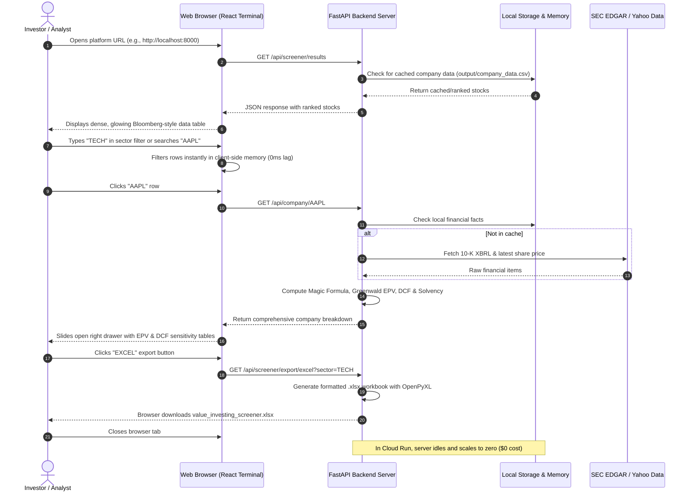

# Value Investing Alpha — Technical Architecture & System Mechanics

> **An Executive & Non-Technical Guide to the Inner Workings of the Platform**  
> Written to explain *how* the platform operates, *why* each technology was chosen, and *what* happens under the hood during the user experience.

---

## 1. What Each Technology Is For

To build a professional, high-speed financial terminal that feels like a Bloomberg or FactSet terminal without costing thousands of dollars a month, we selected a lightweight, serverless stack. Here is what every component does:

| Technology | What It Is | Why We Use It In This Project |
| :--- | :--- | :--- |
| **Python 3.13** | Core Programming Language | The premier language for data science and financial modeling. It executes the mathematical models (Magic Formula, Bruce Greenwald EPV, DCF) and handles big data manipulation cleanly. |
| **edgartools (v6.2)** | Primary SEC Filing Interface | Directly downloads and parses primary-source **SEC XBRL 10-K and 10-Q filings**. Unlike commercial financial APIs that summarize or alter numbers, `edgartools` provides auditable financial statements directly from SEC regulatory filings. |
| **yfinance** | Market Data Client | Pulls live stock market prices, diluted share counts, and market capitalizations. Fundamental balance sheets come from the SEC, but real-time valuations require today's share price. |
| **FastAPI** | Backend Web Framework | A modern, asynchronous Python framework. It serves as the API "bridge" that takes financial calculations and streams them in milliseconds to the user's web browser. It also generates interactive documentation automatically. |
| **Pydantic V2** | Data Validation Engine | Acts as the "border control" for data. It guarantees that every financial ratio, market cap, and ticker symbol is strictly validated and formatted before reaching the user. |
| **React 18** | Frontend User Interface | A high-performance web UI library. It allows instant sorting, searching, and opening company valuation drawers with zero page reloads. |
| **Vite** | Modern Frontend Build Tool | Bundles the React code into optimized, lightweight static assets in just one second, making local development instantaneous. |
| **Tailwind CSS** | Styling System | Enables the **Data-Dense Design** philosophy: dark background palette (`#0a0c10`), thin borders, and monospace font alignment so financial figures can be read as easily as a terminal spreadsheet. |
| **JetBrains Mono** | Tabular Monospace Font | A typeface designed for code and finance. Because every numeral occupies identical character width, columns of numbers (millions vs. billions) align visually without jumping. |
| **Docker** | Container Packaging | Wraps the Python backend, React frontend, and SEC tools into a single lightweight, self-contained unit that runs identically on your Mac, Windows, or Google Cloud. |
| **Google Cloud Run** | Serverless Hosting Service | Runs the Docker container in the cloud. It features **scale-to-zero** capability: when nobody is using the site, it turns off completely, costing **\$0.00**. When you open the website, it starts up in 2 seconds. |

---

## 2. Walkthrough of the User Experience (From Arrival to Sign-Out)

Here is a step-by-step description of what a user experiences and what happens in the system at every stage:



### Step 1: Arriving at the Terminal
When the user navigates to the platform URL, the browser loads the single-page terminal application. The top telemetry bar immediately lights up with live UTC time, system health status, and the number of companies currently loaded in the database.

### Step 2: Instant Screening & Multi-Column Sorting
The user sees a data table packed with financial metrics:
- Joel Greenblatt’s **Earnings Yield (EBIT / Enterprise Value)** and **Return on Capital (ROC)**.
- Bruce Greenwald’s **Reproduction Cost per Share** and **Earning Power Value (EPV) per Share**.
- The **EPV Margin of Safety** (green for undervalued, red for overvalued).
- The **Solvency Traffic Light** (GREEN for fortress balance sheets, YELLOW for moderate debt, RED for speculative liquidity).

The user can click any column header (e.g., *ROC*, *Earnings Yield*, *Market Cap*) to re-sort the universe instantly.

### Step 3: Deep-Dive Valuation Drawer
Clicking on any stock ticker slides open a detail drawer from the right side of the screen. Instead of just showing a final score, the drawer explains the math:
- **Magic Formula Walkthrough**: Shows exactly how Tangible Capital Employed and Excess Cash were calculated.
- **Bruce Greenwald Franchise Moat Ratio**: Compares Earning Power Value against Asset Reproduction Cost. If EPV exceeds Reproduction Cost ($>1.0\times$), the company has a structural economic moat.
- **EPV Sensitivity Table**: Shows what the stock is worth under different Cost of Capital hurdle rates (8%, 9%, 10%, 11%, 12%).
- **DCF Sensitivity Matrix**: A two-dimensional grid testing different discount rates against terminal growth rates.
- **Raw SEC Line Items**: Displays the original balance sheet and income statement items pulled directly from the company's SEC 10-K filing.

### Step 4: Exporting Reports
The user can click **CSV** or **EXCEL** in the toolbar. The server builds a styled, formatted spreadsheet with banded rows and auto-fit columns and downloads it directly to the user's computer.

### Step 5: Disconnecting / Signing Out
The platform is built as an open terminal interface. When the user closes the browser window, no idle background sessions linger. On Google Cloud Run, the cloud container automatically scales down to zero running instances after 15 minutes of inactivity.

---

## 3. How Cache and Memory from Downloaded Data Work

One of the biggest pitfalls when analyzing SEC data is **disk bloat and SSD exhaustion**. SEC XBRL filings for the entire US market exceed **24 Gigabytes** of raw XML and JSON data.

Here is how the platform safely manages cache and memory:

```
[SEC EDGAR Server]
        │
        ▼ (Download via edgartools)
[Local Storage: output/data/ & output/cache/] ──► Preserves SSD via external drive or dedicated folder
        │
        ▼ (Batch-and-Flush: 25 tickers at a time)
[Master Summary: output/company_data.csv]
        │
        ▼ (Read by FastAPI)
[Server RAM (FastAPI)] ──► Kept under 250 MB via garbage collection
        │
        ▼ (Cached response)
[User's Web Browser] ──► Instant client-side filtering without re-querying SEC
```

### A. Preventing Local SSD Exhaustion
By default, standard libraries write files into the user's home folder (`~/.edgar`), quickly filling primary hard drives.
- **Our Safeguard**: The system routes all SEC downloads to a configurable folder controlled by the `EDGAR_LOCAL_DATA_DIR` and `EDGAR_CACHE_DIR` environment variables (e.g., pointing to an external SSD or a dedicated local project folder).

### B. Batch-and-Flush Execution
When screening hundreds of tickers, holding thousands of XBRL filings in Python memory causes crashes.
- **Our Safeguard**: The platform processes tickers in batches (typically 25 at a time). After each batch, raw metrics (EBIT, Current Assets, Net Debt) are saved to `output/company_data.csv`, and Python purges its filing memory cache (`clear_cache()`).

### C. Offline / Fast Cache Mode
Once a company's data has been downloaded, future screener requests read directly from `output/company_data.csv` in **milliseconds**, completely eliminating redundant SEC downloads and avoiding SEC rate limits (the SEC enforces a strict limit of 10 requests per second).

### D. Cloud Run Memory Behavior
When hosted on Google Cloud Run:
- Cloud Run containers use an in-memory temporary filesystem (`/tmp` or `/app/output`).
- The application is configured with a 512 MB to 1 GB memory limit, perfectly sized to keep the pre-compiled screener dataset and active calculations lightning fast while remaining within GCP's permanent free tier.

---

## 4. Important Valuation Mechanics & Financial Logic

### A. Cascading Industrial EBIT Derivation
Operating profit (EBIT) is reported differently across industries. Rather than relying on a single line item, the engine uses a 3-tier cascading fallback:
1. **Tier 1**: SEC standardized XBRL tag `OperatingIncomeLoss`.
2. **Tier 2 (Fallback)**: `PretaxIncomeLoss + InterestExpense`.
3. **Tier 3 (Industrial Structure)**: $\text{Revenue} - \text{CostsSubtotal}$ or $\text{Revenue} - (\text{COGS} + \text{SG\&A} + \text{R\&D})$.

### B. TTM (Trailing Twelve Months) Normalization
Companies report quarterly (10-Q) and annually (10-K). To compare companies whose fiscal years end in different months, the engine standardizes all income statement variables into trailing 12-month units:
$$\text{TTM} = \text{Latest 10-K} + \text{Current Year 10-Q} - \text{Prior Year Equivalent 10-Q}$$

### C. Industry-Specific Excess Cash (SIC Code Adjustments)
The classic Magic Formula subtracts *all* cash from Enterprise Value. However, a business requires a baseline amount of operating cash to pay suppliers and payroll.
- The engine calculates the **median Cash-to-Revenue ratio** across each company's 4-digit SIC code.
- Only cash held *above* the industry operational median is treated as **Excess Cash**, preventing capital-intensive firms from appearing artificially cheap.

### D. Bruce Greenwald Asset Reproduction Cost vs. EPV
1. **Asset Reproduction Cost**: Estimates what a competitor would spend today to replicate the company's assets from scratch (cash + receivables + inventory haircuts + replacement PP&E minus non-interest-bearing liabilities).
2. **Earning Power Value (EPV)**: The value of the firm assuming zero future growth, capitalizing normalized current earnings at the cost of capital ($WACC$):
   $$\text{EPV} = \frac{\text{Normalized EBIT} \times (1 - \text{Tax Rate})}{WACC}$$
3. **The Moat Indicator**:
   - If $\text{EPV} \approx \text{Reproduction Cost}$, the business earns its cost of capital in a competitive market.
   - If $\text{EPV} > \text{Reproduction Cost}$ (Franchise Factor $>1.0$), the company possesses an enduring competitive advantage (moat) that shields its profits from competitors.
